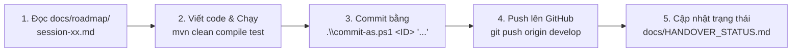

# 📋 BẢNG PHÂN CHIA NHIỆM VỤ & QUẢN LÝ COMMIT NHÓM 04
> **Dự án:** Hệ thống Website Cứu Nạn Thiên Tai (CứuNạn 24/7)  
> **Repository:** [https://github.com/PeterWeeee/disaster-rescue-system.git](https://github.com/PeterWeeee/disaster-rescue-system.git)  
> **Nhánh phát triển chính:** `develop`

---

## 1. Danh Sách Thành Viên & Thông Tin Định Danh

| STT | Mã số / ID | Họ và tên / Tên hiển thị | Email định danh GitHub | Vai trò chuyên trách trong dự án |
| :---: | :---: | :--- | :--- | :--- |
| **1** | `PeterWeeee` | **Tri Thai (PeterWeeee)** | `NguyenTT162.4@gmail.com` | **Trưởng nhóm:** Kiến trúc hệ thống, Backend Core, Real-time WebSocket & Đám mây Cloudinary |
| **2** | `vovanthinh` | **Võ Văn Thịnh** | `vovanthinh2006@gmail.com` | **Thành viên:** Bảo mật & Xác thực (Security/JWT), Phân hệ Người dân & Bản đồ Leaflet.js, Tối ưu Mobile UI |
| **3** | `24110329` | **Sinh viên MSSV 24110329** | `24110329@student.hcmute.edu.vn` | **Thành viên:** Phân hệ Điều phối viên (Coordinator & Haversine), Phân hệ Đội cứu hộ (Rescuer) & Quản trị Admin |

> [!IMPORTANT]
> **LƯU Ý ĐỂ GITHUB TÍNH ĐIỂM ĐÓNG GÓP (CONTRIBUTIONS GRAPH / GREEN SQUARES):**
> 1. Mỗi thành viên cần đăng nhập vào GitHub của mình -> vào **Settings** -> **Emails** -> Thêm đúng địa chỉ email tương ứng ở bảng trên vào tài khoản GitHub (`NguyenTT162.4@gmail.com`, `vovanthinh2006@gmail.com`, `24110329@student.hcmute.edu.vn`).
> 2. Khi commit mang đúng email đó, GitHub sẽ tự động nhận diện và cộng ô xanh (contributions) cho tài khoản cá nhân của từng bạn trên trang chủ và mục Insights của Repository.

---

## 2. Ma Trận Phân Chia Công Việc Chi Tiết (Work Breakdown Structure)

Dự án được chia thành 9 phiên làm việc (Session) hoàn toàn tương ứng với tài liệu trong thư mục `docs/roadmap/`:

```
                                  PHÂN CHIA 9 SESSIONS
┌─────────────────────────────────┬─────────────────────────────────┬─────────────────────────────────┐
│     THÀNH VIÊN 1: PeterWeeee    │   THÀNH VIÊN 2: Võ Văn Thịnh    │   THÀNH VIÊN 3: SV 24110329     │
├─────────────────────────────────┼─────────────────────────────────┼─────────────────────────────────┤
│ • Session 01: Setup & Dual DB   │ • Session 02: Security & JWT    │ • Session 06: Coordinator Dash  │
│ • Session 04: Cloudinary Media  │ • Session 03: SOS & Leaflet GPS │ • Session 07: Rescuer Operations│
│ • Session 05: WebSocket STOMP   │ • Session 09 (Phần UI Mobile)   │ • Session 08: Admin & Broadcast │
│ • Review & Tích hợp mã nguồn    │ • Kiểm thử luồng gửi SOS        │ • Session 09 (Phần Data & Demo) │
└─────────────────────────────────┴─────────────────────────────────┴─────────────────────────────────┘
```

### Chi tiết phân công từng phiên & Trạng thái hoàn thành:

### 👤 Thành viên 1: Tri Thai (PeterWeeee)
- **Session 01 (✅ Đã hoàn thành):** 
  - Khởi tạo mã nguồn Spring Boot 3.3.5, Java 17, Maven.
  - Cấu hình song song đa cơ sở dữ liệu (`application-mysql.yml`, `application-sqlserver.yml`, `application-local.yml`).
  - Base Layout Thymeleaf + Bootstrap 5 (Header, Navbar, Footer, Fragment).
  - Tích hợp tài khoản Cloudinary thực tế.
- **Session 04 (✅ Đã hoàn thành):**
  - Tích hợp Cloudinary Media Upload (`CloudinaryService`, `UploadApiController`).
  - Xử lý kéo thả upload ảnh hiện trường, preview thumbnail và modal xem ảnh phóng to.
- **Session 05 (✅ Đã hoàn thành):**
  - Xây dựng hạ tầng WebSocket Real-time cốt lõi (`WebSocketConfig`, STOMP over SockJS).
  - Kênh `/topic/sos-alerts` bắn sự kiện cứu nạn tức thì không cần F5.
  - Âm thanh chuông báo khẩn cấp và hiệu ứng cập nhật marker bản đồ thời gian thực.

---

### 👤 Thành viên 2: Võ Văn Thịnh (`vovanthinh2006@gmail.com`)
- **Session 02 (✅ Đã hoàn thành):**
  - Cấu hình Spring Security 6 với cơ chế Stateless JWT kết hợp Thymeleaf SSR (lưu token an toàn trong HttpOnly Cookie).
  - Xây dựng Entity `User.java`, `Role.java`, `UserRepository`, `RoleRepository`.
  - Triển khai `JwtUtils`, `JwtAuthenticationFilter`, `CustomUserDetailsService`.
  - Giao diện đăng nhập (`/login`) và đăng ký (`/register`) có mã hóa mật khẩu bằng BCrypt.
  - Phân quyền các route cho 4 vai trò.
- **Session 03 (✅ Đã hoàn thành):**
  - Xây dựng phân hệ Gửi cứu nạn khẩn cấp SOS (`SosRequest.java`, `SosService`, `SosController`).
  - Tích hợp HTML5 Geolocation API lấy tọa độ GPS chính xác với 1 chạm và Reverse geocoding 3 cấp tiếng Việt.
  - Nhúng bản đồ tương tác Leaflet.js + OpenStreetMap (kéo thả ghim vị trí, tự điền kinh độ/vĩ độ).
  - Giao diện người dân theo dõi trạng thái ca cứu hộ (`templates/sos/track.html`).
- **Session 09 (⏳ Đang chuẩn bị):**
  - Tối ưu giao diện Responsive 100% chuẩn Mobile First cho người dân gửi SOS trên điện thoại.

---

### 👤 Thành viên 3: Sinh viên MSSV 24110329 (`24110329@student.hcmute.edu.vn`)
- **Session 06 (✅ Đã hoàn thành):**
  - Xây dựng Trung tâm chỉ huy Điều phối viên (`ROLE_COORDINATOR` - `/coordinator/dashboard`).
  - Lập trình **Thuật toán Haversine Formula** tính khoảng cách địa lý theo tọa độ để gợi ý đội cứu hộ gần nhất.
  - Giao diện điều phối ca cứu hộ dạng Split-Screen, chỉ định đội và cập nhật trạng thái sang `DISPATCHED`.
- **Session 07 (✅ Đã hoàn thành):**
  - Xây dựng Phân hệ Tác nghiệp Đội cứu hộ (`ROLE_RESCUER` - `/rescuer/missions`).
  - Giao diện Đội trưởng nhận nhiệm vụ / từ chối kèm lý do (tự động trả về hàng chờ PENDING).
  - Đội viên cập nhật tiến độ di chuyển hiện trường (`IN_PROGRESS` -> `COMPLETED`).
  - Tải ảnh nghiệm thu hiện trường lên Cloudinary/Local và hoàn tất ca cứu nạn sang `RESOLVED`.
- **Session 08 (✅ Đã hoàn thành):**
  - Xây dựng Phân hệ Quản trị hệ thống (`ROLE_ADMIN` - `/admin/dashboard`).
  - Quản lý danh sách tài khoản người dùng (khóa/mở khóa, đổi role) và quản lý danh sách đội cứu hộ.
  - Chức năng phát sóng khẩn cấp diện rộng (Broadcast Emergency Alert) đẩy popup cảnh báo toàn màn hình qua WebSocket kèm còi báo động.
  - Báo cáo thống kê trực quan với biểu đồ Chart.js từ 100% dữ liệu thực CSDL.
- **Session 09 (⏳ Đang chuẩn bị):**
  - Chuẩn bị Data Seeder (10 ca SOS mẫu, 4 đội cứu hộ, tọa độ vùng ngập lụt miền Trung/TP.HCM) và kịch bản thuyết trình bảo vệ đồ án.

---

## 3. Lộ Trình Commit Mẫu Cho Toàn Bộ Đồ Án

Để lịch sử git đẹp và đồng đều trên GitHub, nhóm tuân thủ lộ trình commit theo bảng sau:

| STT Commit | Session | Tác giả Commit | Email tác giả | Thông điệp Commit chuẩn (Message) | Trạng thái |
| :---: | :---: | :--- | :--- | :--- | :---: |
| `01` | 01 | **Tri Thai** | `NguyenTT162.4@gmail.com` | `feat: complete session 01 - spring boot setup, dual db, cloudinary config, and thymeleaf layout` | ✅ Đã xong |
| `02` | 02 | **Vo Van Thinh** | `vovanthinh2006@gmail.com` | `feat(security): implement user role entity, spring security 6, and jwt filter` | ✅ Đã xong |
| `03` | 02 | **Vo Van Thinh** | `vovanthinh2006@gmail.com` | `feat(auth): complete login register thymeleaf pages and httponly cookie authentication` | ✅ Đã xong |
| `04` | 03 | **Vo Van Thinh** | `vovanthinh2006@gmail.com` | `feat(sos): implement sos request entity, repository, and geolocation 1-touch service` | ✅ Đã xong |
| `05` | 03 | **Vo Van Thinh** | `vovanthinh2006@gmail.com` | `feat(map): integrate leaflet js map for sos marker and citizen tracking page` | ✅ Đã xong |
| `06` | 04 | **Tri Thai** | `NguyenTT162.4@gmail.com` | `feat(cloudinary): implement media upload api, client-side canvas compression, and preview` | ✅ Đã xong |
| `07` | 05 | **Tri Thai** | `NguyenTT162.4@gmail.com` | `feat(websocket): configure stomp broker, sos real-time alerts channel, and sound alarms` | ✅ Đã xong |
| `08` | 05 | **Tri Thai** | `NguyenTT162.4@gmail.com` | `feat(realtime): update live map markers dynamically via websocket topic` | ✅ Đã xong |
| `09` | 06 | **Student 24110329** | `24110329@student.hcmute.edu.vn` | `feat(coordinator): create rescue team entities and implement haversine nearest team algorithm` | ✅ Đã xong |
| `10` | 06 | **Student 24110329** | `24110329@student.hcmute.edu.vn` | `feat(dispatch): build coordinator live dashboard and dispatching operations` | ✅ Đã xong |
| `11` | 07 | **Student 24110329** | `24110329@student.hcmute.edu.vn` | `feat(rescuer): implement mission acceptance, status transition, and completion photo report` | ✅ Đã xong |
| `12` | 08 | **Student 24110329** | `24110329@student.hcmute.edu.vn` | `feat(admin): build user management, emergency broadcast popup, and chartjs analytics` | ✅ Đã xong |
| `13` | 09 | **Vo Van Thinh** | `vovanthinh2006@gmail.com` | `style(mobile): optimize responsive design and touch controls for mobile screens` | ⏳ Đang làm |
| `14` | 09 | **Student 24110329** | `24110329@student.hcmute.edu.vn` | `test(seed): add full realistic demo data seeder and presentation test script` | ⏳ Đang làm |
| `15` | 09 | **Tri Thai** | `NguyenTT162.4@gmail.com` | `chore: finalize project, verify all unit tests, and prepare release on main branch` | ⏳ Đang làm |

---

## 4. Hướng Dẫn Đổi Thông Tin Tác Giả Khi Commit & Push

Để thuận tiện nhất khi một bạn (hoặc AI) ngồi code trên cùng 1 máy tính nhưng vẫn ghi nhận commit chính xác cho từng thành viên, dự án đã trang bị sẵn 2 script PowerShell:

### 🚀 Cách 1: Dùng script `commit-as.ps1` (Khuyên dùng nhất - Nhanh nhất)
Chỉ cần gõ **1 dòng lệnh** duy nhất, script sẽ tự động gán đúng tên & email của người đó, `git add .`, commit và hiển thị tùy chọn push:

```powershell
# Cú pháp: .\commit-as.ps1 <Số_thành_viên> "Thông_điệp_commit" [-Push]

# 1. Commit cho Võ Văn Thịnh (Thành viên 2):
.\commit-as.ps1 2 "feat(security): implement user role entity, spring security 6, and jwt filter"

# 2. Commit cho Sinh viên 24110329 (Thành viên 3):
.\commit-as.ps1 3 "feat(coordinator): build coordinator dashboard and haversine dispatching"

# 3. Commit cho Tri Thai / PeterWeeee (Thành viên 1):
.\commit-as.ps1 1 "feat(websocket): configure stomp broker and real-time sos alerts"

# Muốn commit và PUSH luôn lên GitHub chỉ cần thêm cờ -Push:
.\commit-as.ps1 2 "feat(auth): complete login register thymeleaf pages" -Push
```

---

### 🔄 Cách 2: Dùng script `git-member.ps1` (Chuyển danh tính đang hoạt động)
Dùng khi bạn muốn chuyển hẳn danh tính tác giả hiện tại sang bạn khác:

```powershell
# Xem ai đang là người commit hiện tại:
.\git-member.ps1 -Check

# Chuyển sang PeterWeeee:
.\git-member.ps1 1

# Chuyển sang Võ Văn Thịnh:
.\git-member.ps1 2

# Chuyển sang SV 24110329:
.\git-member.ps1 3
```

---

### 🛠️ Cách 3: Lệnh Git thủ công
Nếu không muốn dùng script PowerShell, bạn có thể truyền trực tiếp cờ `--author` vào lệnh `git commit`:

```bash
# Cho Võ Văn Thịnh:
git add .
git commit --author="Vo Van Thinh <vovanthinh2006@gmail.com>" -m "feat(security): implement jwt filter"
git push origin develop

# Cho SV 24110329:
git add .
git commit --author="Student 24110329 <24110329@student.hcmute.edu.vn>" -m "feat(coordinator): add haversine algorithm"
git push origin develop

# Cho PeterWeeee:
git add .
git commit --author="PeterWeeee <NguyenTT162.4@gmail.com>" -m "feat(websocket): add realtime channel"
git push origin develop
```

---

## 5. Quy Trình Làm Việc Mỗi Phiên (Workflow)



1. **Trước khi code:** Đọc file chi tiết phiên tương ứng trong `docs/roadmap/session-xx.md`.
2. **Sau khi code:** Chạy `mvn clean compile` hoặc `mvn test` để đảm bảo code không lỗi.
3. **Commit đúng người:** Sử dụng `.\commit-as.ps1 <1|2|3> "..."` tương ứng với phân công ở mục 3.
4. **Push lên GitHub:** `git push origin develop`.
5. **Bàn giao ca:** Cập nhật lại `docs/HANDOVER_STATUS.md` để ghi nhận công việc đã hoàn tất.
