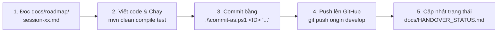

# PHÂN CHIA CÔNG VIỆC NHÓM 04 - ĐỒ ÁN LẬP TRÌNH WEB (HCMUTE)
> **Dự án:** CứuNạn 24/7 - Hệ thống phản ứng khẩn cấp & điều phối cứu hộ thiên tai  
> **Thời gian cập nhật:** 28/10/2026

---

## 1. Thông Tin Thành Viên Nhóm

| STT | Họ và Tên | Mã Số SV | Vai Trò Trong Đồ Án | Email Git / GitHub | Username |
| :---: | :--- | :---: | :--- | :--- | :--- |
| **1** | **Tri Thai** | *Trưởng nhóm* | Architecture, Core WebSocket, Cloudinary & Nâng Cấp UI | `NguyenTT162.4@gmail.com` | `PeterWeeee` |
| **2** | **Võ Văn Thịnh** | **24110329** | Fullstack, Spring Security 6, JWT, GPS SOS & Thống Kê Thu Chi | `vovanthinh2006@gmail.com` | `thinhvo` |
| **3** | **Sinh viên MSSV 24110329** | **24110329** | GIS Haversine, Điều Phối Viên, Tác Nghiệp Cứu Hộ & UI Redesign | `24110329@student.hcmute.edu.vn` | `sv24110329` |

---

## 2. Ma Trận Phân Chia Công Việc Chi Tiết (Work Breakdown Structure)

Dự án được phân chia thành các phiên làm việc (Session) hoàn toàn tương ứng với tài liệu trong thư mục `docs/roadmap/`:

```
                                 PHÂN CHIA CÁC SESSIONS
┌─────────────────────────────────┬─────────────────────────────────┬─────────────────────────────────┐
│     THÀNH VIÊN 1: PeterWeeee    │   THÀNH VIÊN 2: Võ Văn Thịnh    │   THÀNH VIÊN 3: SV 24110329     │
├─────────────────────────────────┼─────────────────────────────────┼─────────────────────────────────┤
│ • Session 01: Setup & Dual DB   │ • Session 02: Security & JWT    │ • Session 06: Coordinator Dash  │
│ • Session 04: Cloudinary Media  │ • Session 03: SOS & Leaflet GPS │ • Session 07: Rescuer Operations│
│ • Session 05: WebSocket STOMP   │ • Kiểm thử luồng gửi SOS        │ • Session 08: Admin & Broadcast │
│ • Session 10: UI Fixes & Page   │                                 │ • Session 09: UI Redesign       │
│ • Session 11: Admin Finance     │                                 │   (Tân trang web & tinh gọn)    │
│ • Session 12: Mission Live Chat │                                 │                                 │
│   (Khung chat khi tiếp cận)     │                                 │                                 │
│ • Review & Tích hợp mã nguồn    │                                 │                                 │
└─────────────────────────────────┴─────────────────────────────────┴─────────────────────────────────┘
 [SESSION CHƯA LÀM]: Tối ưu UI/UX Mobile & Kịch bản bảo vệ (Dời về cuối lộ trình - Chưa làm trong project này)
```

### Chi tiết phân công từng phiên & Trạng thái hoàn thành:

### 👤 Thành viên 1: Tri Thai (PeterWeeee)
- **Session 01 (✅ Đã hoàn thành):** 
  - Khởi tạo mã nguồn Spring Boot 3.3.5, Java 17, Maven.
  - Cấu hình song song đa cơ sở dữ liệu (`application-mysql.yml`, `application-sqlserver.yml`, `application-local.yml`).
  - Base Layout Thymeleaf + Bootstrap 5 (Header, Navbar, Footer, Fragment).
  - Tích hợp tài khoản Cloudinary thực tế.
- **Session 04 (✅ Đã hoàn thành):**
  - Tích hợp Cloudinary Media Upload (`CloudinaryService`, `UploadApiController`).
  - Xử lý kéo thả upload ảnh hiện trường, preview thumbnail và modal xem ảnh phóng to.
- **Session 05 (✅ Đã hoàn thành):**
  - Xây dựng hạ tầng WebSocket Real-time cốt lõi (`WebSocketConfig`, STOMP over SockJS).
  - Kênh `/topic/sos-alerts` bắn sự kiện cứu nạn tức thì không cần F5.
  - Âm thanh chuông báo khẩn cấp và hiệu ứng cập nhật marker bản đồ thời gian thực.
- **Session 10 (✅ Đã hoàn thành - Nhánh `ui-fixes`):**
  - Nâng cấp hoàn thiện sâu trực tiếp từ nhánh `ui-redesign`.
  - Khắc phục triệt để lỗi hiển thị bản đồ GIS Leaflet (xung đột z-index điều khiển và auto resize).
  - Sửa toàn bộ lỗi mã hóa UTF-8 tiếng Việt trong SQL scripts và bộ nạp mẫu `DataInitializer.java`.
  - Tân trang Cổng Quyên Góp Fullwidth Seamless Dark Theme, khắc phục lỗi tương phản chữ trắng trên nền trắng.
  - Triển khai phân trang (Pagination) trên toàn bộ bảng dữ liệu hệ thống (Coordinator, Rescuer, Admin, Feed).
  - Tách riêng trang Lịch sử điều phối chuyên biệt (`coordinator/history.html`).
- **Session 11 (✅ Đã hoàn thành):**
  - Bổ sung phân hệ Báo cáo & Thống kê Thu - Chi minh bạch dành cho Quản trị viên (`ROLE_ADMIN`) tại `/admin/dashboard?view=finance` và `/admin/finance`.
  - Thống kê dòng tiền Thu (Quỹ cơ sở 500tr + Quyên góp từ nhà hảo tâm) và dòng tiền Chi (giải ngân cấp phát cho các đội cứu hộ).
  - 4 thẻ KPI tài chính, 2 biểu đồ Chart.js trực quan (Thu vs Chi và Phân bổ phương thức thanh toán), bảng kê quyên góp và bảng kê giải ngân có phân trang.
- **Session 12 (🆕 Sẵn sàng triển khai):**
  - Tích hợp Khung Chat Trực Tuyến Thời Gian Thực giữa Nạn nhân SOS và Đội cứu hộ khi đang tiếp cận (`IN_PROGRESS`).
  - Hiển thị khung chat trên màn hình theo dõi cứu nạn của người dân (`templates/sos/track.html`) và màn hình bản đồ lộ trình di chuyển của đội cứu hộ (`templates/rescuer/routes.html`).
  - Truyền tải tin nhắn 2 chiều qua WebSocket STOMP (`/topic/chat/{sosId}`) kết hợp REST API fallback và cơ chế lưu trữ bền vững trong cơ sở dữ liệu (`rescue_chat_messages`).
  - Bộ nút gợi ý tin nhắn nhanh khẩn cấp 1-chạm (Quick SOS chips) cho cả hai phía.

---

### 👤 Thành viên 2: Võ Văn Thịnh (`vovanthinh2006@gmail.com`)
- **Session 02 (✅ Đã hoàn thành):**
  - Cấu hình Spring Security 6 với cơ chế Stateless JWT kết hợp Thymeleaf SSR (lưu token an toàn trong HttpOnly Cookie).
  - Xây dựng Entity `User.java`, `Role.java`, `UserRepository`, `RoleRepository`.
  - Triển khai `JwtUtils`, `JwtAuthenticationFilter`, `CustomUserDetailsService`.
  - Giao diện đăng nhập (`/login`) và đăng ký (`/register`) có mã hóa mật khẩu bằng BCrypt.
  - Phân quyền các route cho 4 vai trò.
- **Session 03 (✅ Đã hoàn thành):**
  - Xây dựng phân hệ Gửi cứu nạn khẩn cấp SOS (`SosRequest.java`, `SosService`, `SosController`).
  - Tích hợp HTML5 Geolocation API lấy tọa độ GPS chính xác với 1 chạm và Reverse geocoding 3 cấp tiếng Việt.
  - Nhúng bản đồ tương tác Leaflet.js + OpenStreetMap (kéo thả ghim vị trí, tự điền kinh độ/vĩ độ).
  - Giao diện người dân theo dõi trạng thái ca cứu hộ (`templates/sos/track.html`).

---

### 👤 Thành viên 3: Sinh viên MSSV 24110329 (`24110329@student.hcmute.edu.vn`)
- **Session 06 (✅ Đã hoàn thành):**
  - Xây dựng Trung tâm chỉ huy Điều phối viên (`ROLE_COORDINATOR` - `/coordinator/dashboard`).
  - Lập trình **Thuật toán Haversine Formula** tính khoảng cách địa lý theo tọa độ để gợi ý đội cứu hộ gần nhất.
  - Giao diện điều phối ca cứu hộ dạng Split-Screen, chỉ định đội và cập nhật trạng thái sang `DISPATCHED`.
- **Session 07 (✅ Đã hoàn thành):**
  - Xây dựng Phân hệ Tác nghiệp Đội cứu hộ (`ROLE_RESCUER` - `/rescuer/missions`).
  - Giao diện Đội trưởng nhận nhiệm vụ / từ chối kèm lý do (tự động trả về hàng chờ PENDING).
  - Đội viên cập nhật tiến độ di chuyển hiện trường (`IN_PROGRESS` -> `COMPLETED`).
  - Tải ảnh nghiệm thu hiện trường lên Cloudinary/Local và hoàn tất ca cứu nạn sang `RESOLVED`.
- **Session 08 (✅ Đã hoàn thành):**
  - Xây dựng Phân hệ Quản trị hệ thống (`ROLE_ADMIN` - `/admin/dashboard`).
  - Quản lý danh sách tài khoản người dùng (khóa/mở khóa, đổi role) và quản lý danh sách đội cứu hộ.
  - Chức năng phát sóng khẩn cấp diện rộng (Broadcast Emergency Alert) đẩy popup cảnh báo toàn màn hình qua WebSocket kèm còi báo động.
  - Báo cáo thống kê trực quan với biểu đồ Chart.js từ 100% dữ liệu thực CSDL.
- **Session 09 (✅ Đã hoàn thành - Nhánh `ui-redesign`):**
  - Tân trang toàn bộ giao diện hệ thống theo phong cách chỉ huy cứu hộ hiện đại.
  - Xóa sạch các nội dung thừa thãi, rườm rà (bloatware) trên trang chủ, tập trung vào 3 khối hành động khẩn cấp sống còn (SOS, Bản đồ, Quyên góp).
  - Tái cấu trúc thanh điều hướng: Topbar tinh gọn + Sidebar chuyên dụng theo từng vai trò (`fragments/sidebar.html`).
  - Thiết kế bộ UI Preview độc lập (`ui-preview/`).

---

### ⏸️ Session Chưa Làm (Đưa về cuối lộ trình - Chưa thực hiện trong project này)
- **Tài liệu:** [`docs/roadmap/session-chua-lam-mobile-testing-demo-script.md`](roadmap/session-chua-lam-mobile-testing-demo-script.md)
- **Phụ trách:** Cả nhóm
- **Nội dung:** Tối ưu hóa sâu responsive 100% trên các thiết bị di động, nạp dữ liệu mẫu tự động và kịch bản thuyết trình demo bảo vệ đồ án trước hội đồng.

---

## 3. Lộ Trình Commit Mẫu Cho Toàn Bộ Đồ Án

Để lịch sử git đẹp và đồng đều trên GitHub, nhóm tuân thủ lộ trình commit theo bảng sau:

| STT Commit | Session | Tác giả Commit | Email tác giả | Thông điệp Commit chuẩn (Message) | Trạng thái |
| :---: | :---: | :--- | :--- | :--- | :---: |
| `01` | 01 | **Tri Thai** | `NguyenTT162.4@gmail.com` | `feat: complete session 01 - spring boot setup, dual db, cloudinary config, and thymeleaf layout` | ✅ Đã xong |
| `02` | 02 | **Vo Van Thinh** | `vovanthinh2006@gmail.com` | `feat(security): implement user role entity, spring security 6, and jwt filter` | ✅ Đã xong |
| `03` | 02 | **Vo Van Thinh** | `vovanthinh2006@gmail.com` | `feat(auth): complete login register thymeleaf pages and httponly cookie authentication` | ✅ Đã xong |
| `04` | 03 | **Vo Van Thinh** | `vovanthinh2006@gmail.com` | `feat(sos): implement sos request entity, repository, and geolocation 1-touch service` | ✅ Đã xong |
| `05` | 03 | **Vo Van Thinh** | `vovanthinh2006@gmail.com` | `feat(map): integrate leaflet js map for sos marker and citizen tracking page` | ✅ Đã xong |
| `06` | 04 | **Tri Thai** | `NguyenTT162.4@gmail.com` | `feat(cloudinary): implement media upload api, client-side canvas compression, and preview` | ✅ Đã xong |
| `07` | 05 | **Tri Thai** | `NguyenTT162.4@gmail.com` | `feat(websocket): configure stomp broker, sos real-time alerts channel, and sound alarms` | ✅ Đã xong |
| `08` | 05 | **Tri Thai** | `NguyenTT162.4@gmail.com` | `feat(realtime): update live map markers dynamically via websocket topic` | ✅ Đã xong |
| `09` | 06 | **Student 24110329** | `24110329@student.hcmute.edu.vn` | `feat(coordinator): create rescue team entities and implement haversine nearest team algorithm` | ✅ Đã xong |
| `10` | 06 | **Student 24110329** | `24110329@student.hcmute.edu.vn` | `feat(dispatch): build coordinator live dashboard and dispatching operations` | ✅ Đã xong |
| `11` | 07 | **Student 24110329** | `24110329@student.hcmute.edu.vn` | `feat(rescuer): implement mission acceptance, status transition, and completion photo report` | ✅ Đã xong |
| `12` | 08 | **Student 24110329** | `24110329@student.hcmute.edu.vn` | `feat(admin): build user management, emergency broadcast popup, and chartjs analytics` | ✅ Đã xong |
| `13` | 09 | **Student 24110329** | `24110329@student.hcmute.edu.vn` | `feat(ui): redesign rescue portal and role navigation` | ✅ Đã xong |
| `14` | 10 | **Tri Thai** | `NguyenTT162.4@gmail.com` | `fix(ui): resolve map rendering, encoding, pagination, and route status bugs` | ✅ Đã xong |
| `15` | 10 | **Tri Thai** | `NguyenTT162.4@gmail.com` | `feat(ui): update homepage scale, donation fullwidth seamless dark layout, and brand spacing` | ✅ Đã xong |
| `16` | 10 | **Tri Thai** | `NguyenTT162.4@gmail.com` | `feat(ui): refine coordinator navigation, add dedicated dispatch history, and implement pagination across all role tables` | ✅ Đã xong |
| `17` | 11 | **Tri Thai** | `NguyenTT162.4@gmail.com` | `feat(admin): implement revenue and expenditure statistics dashboard with chartjs and pagination` | ✅ Đã xong |
| `18` | Cuối | **Cả nhóm** | `24110329@student.hcmute.edu.vn` | `chore: future mobile testing and presentation demo script` | ⏸️ Chưa làm |

---

## 4. Hướng Dẫn Đổi Thông Tin Tác Giả Khi Commit & Push

Để thuận tiện nhất khi một bạn (hoặc AI) ngồi code trên cùng 1 máy tính nhưng vẫn ghi nhận commit chính xác cho từng thành viên, dự án đã trang bị sẵn 2 script PowerShell:

### 🚀 Cách 1: Dùng script `commit-as.ps1` (Khuyên dùng nhất - Nhanh nhất)
Chỉ cần gõ **1 dòng lệnh** duy nhất, script sẽ tự động gán đúng tên & email của người đó, `git add .`, commit và hiển thị tùy chọn push:

```powershell
# Cú pháp: .\commit-as.ps1 <Số_thành_viên> "Thông_điệp_commit" [-Push]

# 1. Commit cho Võ Văn Thịnh (Thành viên 2):
.\commit-as.ps1 2 "feat(admin): implement revenue and expenditure statistics dashboard"

# 2. Commit cho Sinh viên 24110329 (Thành viên 3):
.\commit-as.ps1 3 "feat(ui): redesign rescue portal and role navigation"

# 3. Commit cho Tri Thai / PeterWeeee (Thành viên 1):
.\commit-as.ps1 1 "fix(ui): resolve map rendering, encoding, pagination, and route status bugs"
```

---

### 🔄 Cách 2: Dùng script `git-member.ps1` (Chuyển danh tính đang hoạt động)
```powershell
# Xem ai đang là người commit hiện tại:
.\git-member.ps1 -Check

# Chuyển sang PeterWeeee:
.\git-member.ps1 1

# Chuyển sang Võ Văn Thịnh:
.\git-member.ps1 2

# Chuyển sang SV 24110329:
.\git-member.ps1 3
```

---

## 5. Quy Trình Làm Việc Mỗi Phiên (Workflow)



1. **Trước khi code:** Đọc file chi tiết phiên tương ứng trong `docs/roadmap/session-xx.md`.
2. **Sau khi code:** Chạy `mvn clean compile` hoặc `mvn test` để đảm bảo code không lỗi.
3. **Commit đúng người:** Sử dụng `.\commit-as.ps1 <1|2|3> "..."` tương ứng với phân công ở mục 3.
4. **Push lên GitHub:** `git push origin develop`.
5. **Bàn giao ca:** Cập nhật lại `docs/HANDOVER_STATUS.md` để ghi nhận công việc đã hoàn tất.
